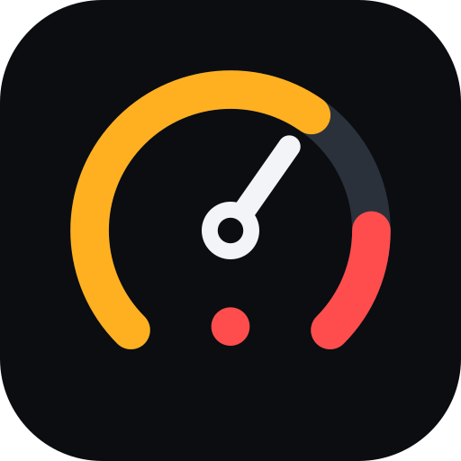
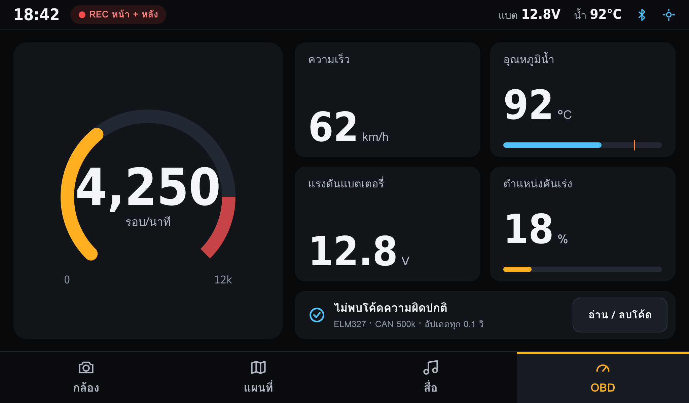
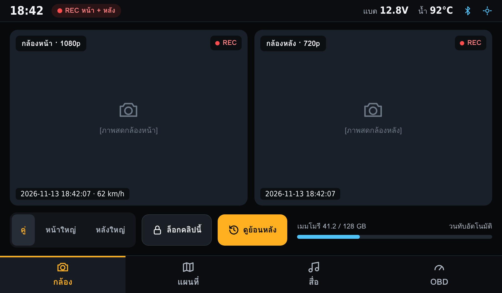
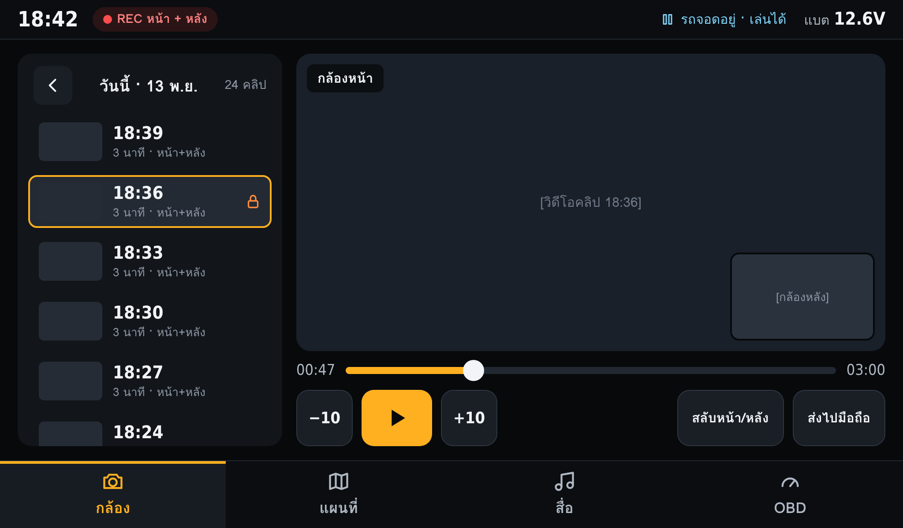
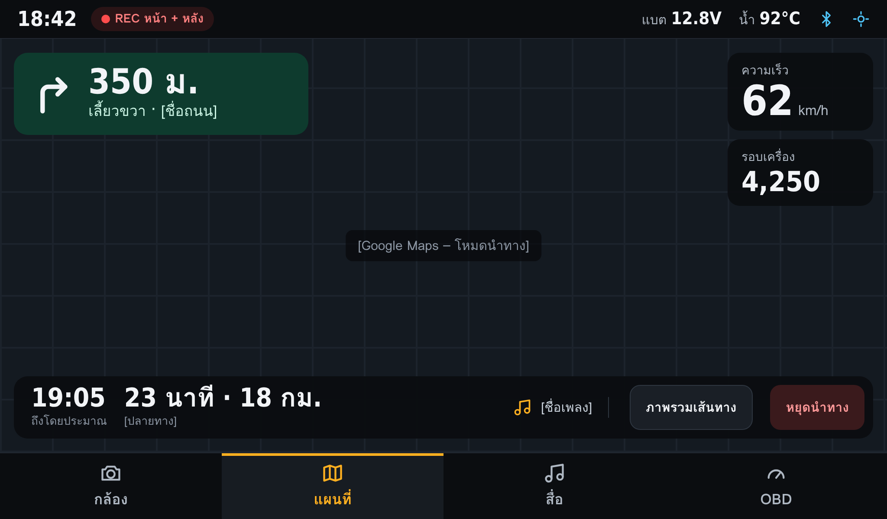
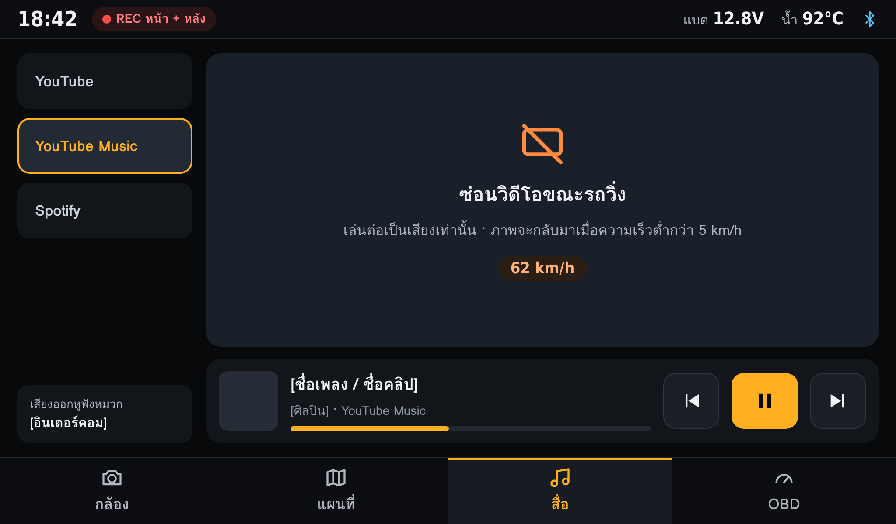
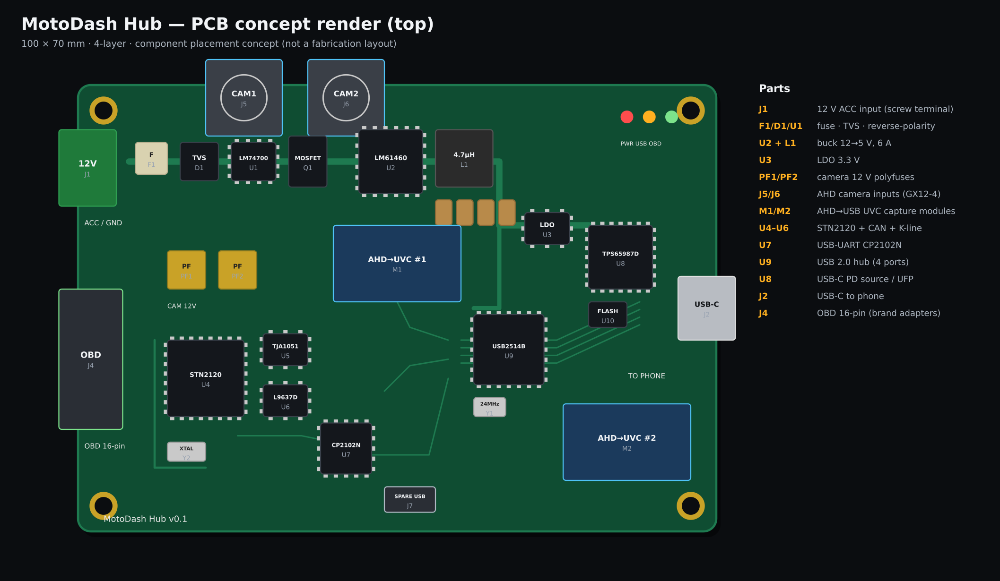
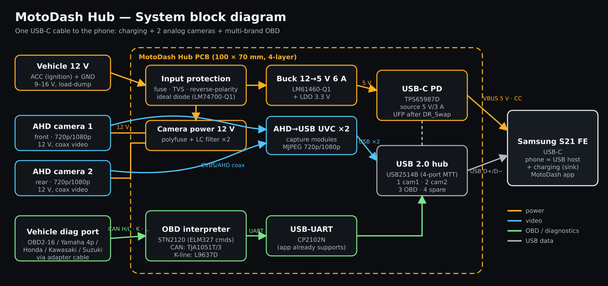

<p align="center">
  
</p>

<h1 align="center">MotoDash</h1>

<p align="center">
  จอแดชบอร์ดสำหรับ <b>Yamaha Tracer 900GT (2018)</b> บนมือถือ <b>Samsung Galaxy S21 FE</b><br>
  กล้องหน้ารถ · แผนที่ · เพลง · ค่า OBD ในแอปเดียว
</p>



---

## หน้าจอ

แอปแสดงผล **แนวนอนเสมอ** มี 4 แท็บด้านล่าง: **หน้าปัด · กล้อง · แผนที่ · สื่อ** และแถบสถานะด้านบน (เวลา, สถานะบันทึก, แรงดันแบต, อุณหภูมิน้ำ, Bluetooth) ที่เห็นได้ทุกหน้า ทุกอย่างทำงาน**ในแอปนี้** ไม่เด้งออกไปแอปอื่น

| กล้อง | ดูย้อนหลัง |
|---|---|
|  |  |
| **แผนที่** | **สื่อ (ขณะรถวิ่ง)** |
|  |  |

> รูปด้านบนเป็นหน้าจอจากไฟล์ออกแบบรุ่นแรก ตัวเลขเป็นค่าตัวอย่าง หน้าจอจริงในเวอร์ชันนี้จัดวางคล้ายกัน แต่มีส่วนที่เปลี่ยนตามรายการด้านล่าง

## ความสามารถ

| แท็บ | ทำอะไรได้ |
|---|---|
| **หน้าปัด** (แท็บแรก) | เกจใหญ่ (ค่าเริ่มต้น: **วงโค้ง = รอบเครื่อง, ตัวเลขกลาง = ความเร็ว**) + ช่องค่า **ปรับแต่งได้เอง**: กดปุ่มปรับแต่ง (ไอคอนแถบเลื่อน) มุมขวาบนของเกจ → แตะช่องเพื่อเลือกค่า (ความเร็ว, รอบเครื่อง, อุณหภูมิน้ำ, แรงดันแบต, คันเร่ง, ความเร็ว GPS, ความสูง, เวลา) · เลือก 4 หรือ 6 ช่อง · เลือกเกจรอบเครื่องหรือเกจความเร็ว · อ่าน/ลบโค้ดความผิดปกติผ่าน ELM327 (ลบได้เฉพาะตอนจอด) |
| **กล้อง** | เปิด **กล้องหลังมือถือ (มองถนน)** และ **กล้องเซลฟี่** พร้อมกัน บันทึกตลอด **ไฟล์ละ 10 นาที** วนทับ · **ลากซ้าย–ขวา** ที่ภาพเพื่อเลือกว่ากล้องไหนใหญ่ (หรือเต็มจอ) · ล็อกคลิป |
| **ดูย้อนหลัง** | เลือกดู **กล้องหน้า / กล้องหลัง / ทั้งสองกล้องพร้อมกัน** (เล่นตรงกัน) · ล็อกขณะรถวิ่ง |
| **แผนที่** | แผนที่ **OpenStreetMap ในแอป** (โทนมืด) · ค้นหาปลายทาง (ล็อกการพิมพ์ขณะรถวิ่ง) · นำทางพร้อม **บอกทางเลี้ยวภาษาไทย ทั้งบนจอและเสียง** (ปุ่มเปิด/ปิดเสียงอยู่ข้างปุ่มหยุดนำทาง) · หาเส้นทางใหม่อัตโนมัติเมื่อออกนอกเส้น · ปลายทางล่าสุด |
| **สื่อ** | เลือกได้ทีละอย่าง และ**เล่นต่อแม้สลับแท็บ**: **เพลงในเครื่อง** (รายการเพลง, สุ่ม, ก่อนหน้า/ถัดไป) · **YouTube ในแอป** (ไม่มีแถบหัว/ปุ่มเปิดแอป มีแถบค้นหาเล็กของเราแทน ซ่อนภาพขณะรถวิ่ง เสียงเล่นต่อ) · **YouTube Music / Spotify** สั่งเล่นเบื้องหลังโดยไม่สลับแอป + ปก, ชื่อเพลง, เวลา |

ระบบเบื้องหลัง
- **บันทึกต่อเนื่อง** ทุกแท็บ (Foreground Service)
- **ตามสวิตช์กุญแจ:** ไฟเข้า → เริ่มบันทึกและปลุกจอ · ไฟหายนาน 10 วินาที → หยุดบันทึก แล้วจอดับเอง
- **ความเร็ว** ใช้ค่าจาก OBD ก่อน ถ้าไม่มีใช้ GPS · ถือว่า "รถวิ่ง" เมื่อ ≥ 5 km/h
- **ปุ่มบนแฮนด์:** รีโมตหรือคีย์บอร์ด Bluetooth ◀ ▶ / Page Up-Down = เลื่อนแท็บ, F1–F4 = หน้าปัด / กล้อง / แผนที่ / สื่อ

## ฮาร์ดแวร์: MotoDash Hub (บอร์ดเสริม)

บอร์ดเดียวต่อมือถือด้วย **USB-C เส้นเดียว**: ชาร์จไฟจาก ACC 12 V · กล้อง **AHD Analog 2 ตัว** (แปลงเป็น USB UVC) · **OBD2/CAN หลายยี่ห้อ** ผ่าน STN2120 (คำสั่ง ELM327) พร้อมสายแปลง Yamaha / Honda / Kawasaki / Suzuki / OBD2-16





รายละเอียดวงจร, BOM, ขาเชื่อมต่อ และสิ่งที่ต้องแก้ในแอป → [hardware/README.md](hardware/README.md) (สถานะ: แบบแนวคิด v0.1)

## สิ่งที่ต้องมี

- Samsung Galaxy S21 FE (หรือ Android 12 ขึ้นไป)
- ELM327 แบบใดก็ได้: **สาย USB** (ต่อมือถือผ่านหัวแปลง OTG), **Bluetooth Classic** หรือ **WiFi** + สายแปลง **Yamaha 4 ขา → OBD2** (ปลั๊กอยู่ใต้เบาะ)
- ถ้าใช้ ELM327 แบบสาย USB และต้องชาร์จมือถือไปด้วย: หัวแปลง USB-C OTG ที่มีช่องชาร์จ (PD)
- ขายึดมือถือ **ที่มีตัวกันสั่น** และช่องชาร์จ USB-C ที่ติดตามสวิตช์กุญแจ
- Mac หรือ Linux สำหรับ build (`setup-dev.sh` ติดตั้งที่เหลือให้)

## Build

ใช้วิธีเดียวกับโปรเจกต์ Mobile Remote ไม่ต้องใช้ Android Studio

### 1. ตั้งค่าเครื่อง (ครั้งเดียว)

```bash
./setup-dev.sh            # ติดตั้ง JDK 17, Android SDK 35, Gradle ผ่าน Homebrew แล้วลอง build
./setup-dev.sh --no-build # ติดตั้งอย่างเดียว
./setup-dev.sh --doctor   # เช็กว่าติดตั้งอะไรแล้วบ้าง
```

| ส่วนประกอบ | เวอร์ชัน |
|---|---|
| JDK | 17 |
| Android SDK Platform / Build-Tools | 35 / 35.0.0 |
| Gradle (wrapper) | 8.9 |
| Android Gradle Plugin / Kotlin | 8.7.3 / 2.0.21 |

สคริปต์เขียน `~/.motodash-env` และผูกไว้กับ `~/.zshrc` ถ้าเครื่องเคยตั้งค่า Mobile Remote แล้ว `build.sh` จะใช้ `~/.mobileremote-env` เดิมได้เลย

### 2. Build และติดตั้ง

```bash
cd ~/Desktop/"Moto dashboard"/MotoDash
./build.sh            # ได้ไฟล์ MotoDash.apk
./build.sh install    # build + ติดตั้งลงทุกเครื่องที่ต่อ adb + ให้สิทธิ์ + เปิดแอป
./build.sh clean      # ล้างแล้ว build ใหม่
```

`build.sh install` ติดตั้งด้วย `--user 0` (ไม่ลงไปใน Secure Folder / Dual Messenger) ให้สิทธิ์ กล้อง ตำแหน่ง Bluetooth การแจ้งเตือน และ**การควบคุมเพลง**ล่วงหน้า และตั้งให้ทำงานเบื้องหลังได้ไม่จำกัด

## ติดตั้งลงมือถือ

1. **การตั้งค่า › เกี่ยวกับโทรศัพท์ › ข้อมูลซอฟต์แวร์** กด **หมายเลขรุ่นสร้าง** 7 ครั้ง
2. **การตั้งค่า › ตัวเลือกนักพัฒนา** เปิด **การแก้ไขข้อบกพร่อง USB**
3. ต่อสาย USB แล้วกดอนุญาตบนมือถือ
4. รัน `./build.sh install`

ต่อแบบไร้สาย: `adb pair <ip>:<port>` แล้ว `adb connect <ip>:<port>`

## ตั้งค่าครั้งแรกในแอป

1. ในแอปกด ⚙ มุมขวาบน → เลือกวิธีต่อ ELM327:
   - **สาย USB:** เสียบสายผ่านหัวแปลง OTG แล้วกด "อนุญาต" (ติ๊ก "ใช้ทุกครั้ง") แอปเปิดเองทุกครั้งที่เสียบสาย
   - **Bluetooth:** จับคู่ในตั้งค่า Bluetooth ก่อน (รหัสมักเป็น `1234` หรือ `0000`) แล้วเลือกจากรายการ
   - **WiFi:** ต่อ WiFi ของ ELM327 แล้วใส่ IP/พอร์ต (ปกติ `192.168.0.10:35000`)
2. หน้าตั้งค่ามีปุ่ม **ตั้งค่า WiFi** และ **ตั้งค่า Bluetooth** ของเครื่องให้กดได้เลย
3. ตั้งเป็นหน้าจอหลัก: กดปุ่มโฮม → เลือก **MotoDash** → **ใช้ทุกครั้ง**

ค่าแนะนำบน S21 FE (One UI)
- **แบตเตอรี่ › ปกป้องแบตเตอรี่** เปิด (จำกัดการชาร์จ ลดแบตบวม)
- **การแจ้งเตือน › MotoDash** อนุญาต "การแจ้งเตือนแบบเต็มหน้าจอ" (ใช้ปลุกจอตอนไฟเข้า)
- จอ**ติดตลอด ไม่หรี่ ไม่ดับ**เป็นค่าเริ่มต้น (ปิดได้ใน ⚙ › หน้าจอ) และเลือก**ความสว่างสูงสุด**สำหรับกลางแดดได้
- ถ้าปิด "จอติดตลอด": จอจะติดเฉพาะตอนมีไฟเข้า แล้วดับตามเวลาหมดหน้าจอของเครื่องหลังดับกุญแจ

คลิปเก็บที่ `Android/data/com.motodash.tracer/files/Movies/clips` (`F_<เวลา>.mp4` = กล้องหน้า, `R_<เวลา>.mp4` = กล้องหลัง) · คลิปที่ล็อกอยู่ใน `locked` ไม่ถูกลบอัตโนมัติ

## โครงสร้างโค้ด

```
app/src/main/java/com/motodash/tracer/
├── MainActivity.kt          หน้าจอหลัก, สิทธิ์, GPS, ปุ่มคีย์บอร์ด
├── AppState.kt              ข้อมูลกลาง (OBD, กล้อง, ความเร็ว, ไฟเข้า)
├── Prefs.kt                 ค่าตั้งค่า
├── AppLauncher.kt           รายชื่อแอปเพลง, ปุ่มเพลงสำรอง
├── map/Navigator.kt         ค้นหา (Nominatim), เส้นทาง (OSRM), บอกทางเลี้ยวภาษาไทย
├── media/NowPlaying.kt      อ่าน/ควบคุมเพลงจากแอปอื่นผ่าน MediaSession
├── obd/Elm327Client.kt      ELM327 ผ่านสาย USB / Bluetooth / WiFi → ATSP6, PID 0C 0D 05 11, ATRV, Mode 03/04
├── camera/DashcamService.kt 2 กล้องพร้อมกัน, ไฟล์ละ 10 นาที, ไฟเข้า/ออก, OBD
├── camera/ClipRepository.kt ไฟล์คลิป, ล็อก, ลบเก่าเมื่อเต็ม
└── ui/                      Theme, Components, แท็บทั้ง 4, Playback, Settings
app/src/main/res/
├── drawable/                ไอคอนแอป (vector), ไอคอนแจ้งเตือน
└── mipmap-anydpi-v26/       adaptive icon (รองรับธีมไอคอนสีเดียว)
docs/                        รูปประกอบ README
```

## ข้อจำกัด

- **2 กล้องพร้อมกัน** ใช้ได้เฉพาะเครื่องที่ Android รองรับ (Concurrent Camera) ความละเอียดสูงสุดกล้องละ 720p ถ้าเครื่องไม่รองรับ แอปจะบันทึกกล้องหน้าอย่างเดียวที่ 1080p และแจ้งบนจอ
- ระหว่างตัดไฟล์คลิปมีช่วงที่ไม่ได้บันทึกประมาณ 0.5–1 วินาที
- แผนที่และเส้นทางใช้บริการฟรีของ OpenStreetMap / OSRM ต้องมีอินเทอร์เน็ต เส้นทางเป็นแบบรถยนต์ (ไม่มีโหมดมอเตอร์ไซค์) และบริการฟรีไม่รับประกันความเสถียร
- YouTube ในแอปเป็นเว็บมือถือ ล็อกอินบัญชี Google ในแอปไม่ได้
- เพลงจาก YouTube Music / Spotify: แอปจะเล่นเพลง/เพลย์ลิสต์ล่าสุดที่เคยเล่นในแอปนั้นต่อ ถ้าสั่งเบื้องหลังไม่ติด จะเห็นแอปนั้นขึ้นมาประมาณ 2 วินาที แล้ว MotoDash กลับมาเอง
- YouTube ในแอป: ถ้าปิดจอ/ล็อกเครื่อง YouTube (เว็บ) อาจหยุดเล่นเอง เพราะการเล่นเบื้องหลังเป็นฟีเจอร์ของ YouTube Premium
- ELM327 แบบสาย USB ต้องเป็นชิป FTDI, CH340, PL2303 หรือ CP210x (ส่วนใหญ่ในตลาด) ที่ความเร็ว 38400 · Bluetooth ต้องเป็นแบบ Classic (ไม่ใช่ BLE)
- ค่าที่ขึ้น `--` คือ ECU ของรถไม่ตอบค่านั้น

## ความปลอดภัย

- ใช้ขายึดที่มีตัวกันสั่น เพื่อไม่ให้ระบบกันสั่นกล้อง (OIS) ของมือถือเสีย
- ตั้งค่าทุกอย่างตอนรถจอด และมองจอเมื่อจำเป็นเท่านั้น
