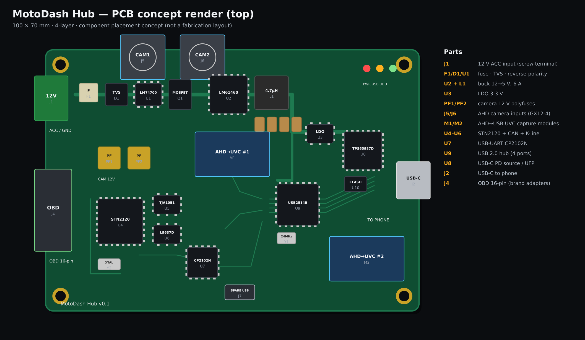
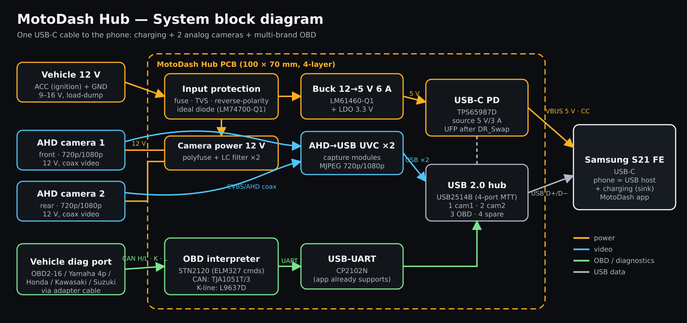
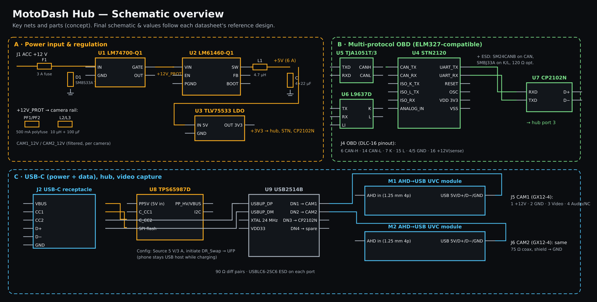

# MotoDash Hub — บอร์ดเชื่อมต่อ (ฮาร์ดแวร์)

บอร์ดเดียวที่รวม **ไฟเลี้ยง + กล้อง Analog (AHD) 2 ตัว + OBD2/CAN หลายยี่ห้อ** แล้วส่งทุกอย่างเข้ามือถือผ่าน **สาย USB-C เส้นเดียว** ทั้งชาร์จไฟและรับข้อมูลพร้อมกัน

> สถานะ: **v0.1 แบบแนวคิด (concept)** มีบล็อกไดอะแกรม วงจรภาพรวม ตำแหน่งวางอุปกรณ์ และ BOM
> ยังไม่ใช่ไฟล์ผลิตจริง (Gerber) ก่อนสั่งทำ PCB ต้องวาดวงจรใน KiCad ตามวงจรอ้างอิงใน datasheet ของแต่ละชิป

## บล็อกไดอะแกรม

| ส่วน | หน้าที่ | ชิปหลัก |
|---|---|---|
| ภาคจ่ายไฟ | 12 V จาก ACC → ฟิวส์ → TVS → กันกลับขั้ว → buck 5 V 6 A → LDO 3.3 V | LM74700-Q1, LM61460-Q1, TLV75533 |
| USB-C ไปมือถือ | ให้ไฟ 5 V/3 A เข้ามือถือ และให้**มือถือยังเป็น USB host** หลัง DR_Swap | TPS65987D |
| USB hub | แยก 4 พอร์ต: กล้อง 1, กล้อง 2, OBD, สำรอง | USB2514B |
| กล้อง | แปลง AHD 720p/1080p → USB UVC (MJPEG/YUY2) ไม่ต้องลงไดรเวอร์ | โมดูล AHD→UVC ×2 |
| OBD | แปลงทุกโปรโตคอล OBD-II เป็น UART (ใช้คำสั่ง ELM327 ได้) | STN2120 + TJA1051T/3 + L9637D |
| USB-UART | OBD เข้า USB (แอปรองรับ CP210x อยู่แล้ว) | CP2102N |

## วงจรภาพรวม

### A · ภาคจ่ายไฟ
- **J1** ขั้วต่อสกรู 12 V ให้ต่อกับ **ACC** (ไฟติดตามกุญแจ) เพื่อให้แอปเริ่มและหยุดบันทึกเองเมื่อบิดกุญแจ
- **F1** ฟิวส์ 3 A, **D1** TVS SM8S33A ป้องกัน load-dump, **U1** LM74700-Q1 + MOSFET กันต่อกลับขั้ว (ไฟตกน้อยกว่าไดโอด)
- **U2** LM61460-Q1 buck 12→5 V 6 A (เกรดรถยนต์) แล้ว **U3** LDO 3.3 V สำหรับ hub, STN2120 และ CP2102N
- ไฟกล้อง 12 V แยกตัวละเส้น: polyfuse 500 mA + LC filter (10 µH + 100 µF) ลดเส้นสัญญาณรบกวนในภาพ

### B · OBD หลายยี่ห้อ
- **STN2120** รองรับ OBD-II ทุกโปรโตคอลตามกฎหมาย คือ CAN (ISO 15765-4), ISO 9141-2, ISO 14230 (KWP2000), J1850 VPW/PWM รวมทั้ง raw CAN, J1939, SW-CAN และ MS-CAN
- ใช้คำสั่ง ELM327 ได้ จึงแทบไม่ต้องแก้แอป
- **TJA1051T/3** สำหรับ CAN H/L, **L9637D** สำหรับ K-line/L-line
- ป้องกันขา: SM24CANB บน CAN, SMBJ33A บน K/L, ตัวต้านทาน terminate 120 Ω แบบจัมเปอร์ (ปกติไม่ใส่)

### C · USB และกล้อง
- **TPS65987D** ตั้งค่าเป็น Source 5 V/3 A แล้วสั่ง DR_Swap เป็น UFP เพื่อให้มือถือเป็น host (คุมกล้องและ OBD) และชาร์จได้พร้อมกัน
- **USB2514B** เป็น hub แบบ Multi-TT ทำให้กล้อง 2 ตัวส่งภาพพร้อมกันได้ราบรื่นกว่า hub แบบ Single-TT
- สาย USB D+/D− เดินเป็นคู่ 90 Ω และใส่ ESD USBLC6-2SC6 ทุกพอร์ต

## ขั้วต่อ (Pinout)

| ขั้วต่อ | ชนิด | ขา |
|---|---|---|
| J1 ไฟเข้า | Screw terminal 2P | 1 +12 V ACC · 2 GND |
| J2 มือถือ | USB-C receptacle | VBUS, CC1/2, D+/D−, GND |
| J4 OBD | Header 2×8 (ลำดับขาแบบ DLC-16) | 6 CAN-H · 14 CAN-L · 7 K · 15 L · 4/5 GND · 16 +12 V (วัดแรงดัน) |
| J5 / J6 กล้อง | GX12-4 กันน้ำ | 1 +12 V · 2 GND · 3 Video (coax 75 Ω) · 4 Audio/NC |
| J7 สำรอง | USB-A หรือ header | ปุ่มแฮนด์ (MCU) / แฟลชไดรฟ์ |

### สายแปลง OBD แยกตามยี่ห้อ
ใช้บอร์ดเดียวกันทุกคัน แล้วเปลี่ยนแค่สายแปลงจากขั้วต่อของรถไปเป็น J4

| รถ | ขั้วต่อ | โปรโตคอล |
|---|---|---|
| Yamaha (Tracer 900GT 2018 ฯลฯ) | 4-pin Yamaha | CAN 500k 11-bit (ATSP6) |
| Honda | 4-pin / 6-pin DLC | K-line (KWP) หรือ CAN |
| Kawasaki | 4-pin / 6-pin KDS | K-line / CAN |
| Suzuki | 6-pin SDS | K-line |
| KTM / BMW / Ducati / Triumph | 6-pin / 10-pin หรือ OBD2-16 | CAN |
| รถยนต์ทั่วไป | OBD2-16 มาตรฐาน | ตรวจหาอัตโนมัติ (ATSP0) |

> ลำดับขาของแต่ละรุ่นอาจต่างกัน ให้ตรวจกับคู่มือซ่อมของรุ่นนั้นก่อนทำสาย

## งบไฟ (Power budget)

| โหลด | กระแสโดยประมาณ |
|---|---|
| ชาร์จมือถือ (5 V) | 2.0–3.0 A |
| โมดูล AHD→UVC ×2 (5 V) | 2 × 0.25 A |
| Hub + STN2120 + CP2102N | ~0.2 A |
| **รวมราง 5 V** | **~3.7 A** (buck 6 A เหลือเผื่อ) |
| กล้อง AHD ×2 (12 V) | 2 × 0.15–0.3 A |

## BOM (ชิ้นหลัก)

| Ref | ชิ้นส่วน | หมายเหตุ |
|---|---|---|
| U1 + Q1 | LM74700-Q1 + N-MOSFET 40 V | กันต่อกลับขั้ว |
| D1 | SM8S33A | TVS load-dump |
| U2 + L1 | LM61460-Q1 + 4.7 µH | Buck 5 V 6 A |
| U3 | TLV75533 | LDO 3.3 V |
| U8 + U10 | TPS65987D + SPI flash | USB-C PD (config ด้วย TPS6598x Config Tool) |
| U9 + Y1 | USB2514B + 24 MHz | USB 2.0 hub 4 พอร์ต MTT |
| U4 + Y2 | STN2120 + คริสตัลตามที่ datasheet กำหนด | OBD interpreter |
| U5 | TJA1051T/3 | CAN transceiver |
| U6 | L9637D | K-line transceiver |
| U7 | CP2102N | USB-UART |
| M1, M2 | โมดูล AHD→USB UVC | ขาเข้า 1.25 mm 4-pin, ขาออก USB |
| PF1, PF2 | Polyfuse 500 mA | ไฟกล้อง |
| ESD | USBLC6-2SC6, SM24CANB, SMBJ33A | ป้องกันพอร์ต |
| J1–J7 | Screw terminal, USB-C, header 2×8, GX12-4 ×2 | |

## แนวทางวางลายวงจร
- PCB 4 ชั้น (Signal / GND / Power / Signal) ขนาด 100 × 70 มม. รูยึด M3 ×4 ใส่กล่องกันน้ำ IP65
- วาง buck ไว้ด้านไฟเข้า ห่างจากโมดูลกล้องและ hub ให้ loop SW–L1–C สั้นที่สุด
- คู่ USB เดิน 90 Ω ให้สั้นและไม่ข้ามรอยแยกของ GND
- แยก GND ภาพกล้อง (ชีลด์ coax) ไปลงจุดเดียวใกล้ขั้วต่อ
- ขั้วต่อทุกตัวที่ออกนอกกล่องต้องมี TVS/ESD อยู่ติดขั้วต่อ

## สิ่งที่ต้องแก้ในแอปเมื่อใช้บอร์ดนี้
1. **กล้อง USB (UVC) 2 ตัว** ใช้ไลบรารี UVC (เช่น AndroidUSBCamera/libuvc) แทนกล้องมือถือ แล้วบันทึกเป็นไฟล์ละ 10 นาทีเหมือนเดิม
2. **OBD ผ่าน USB** ใช้ ElmLink.USB ที่มีอยู่แล้ว เพราะ CP2102N อยู่ใน usb-serial-for-android เพิ่มแค่การหา baud อัตโนมัติ (STN2120 ตั้งได้สูงสุด 10 Mbps)
3. **โปรโตคอล** เปลี่ยน `ATSP6` เป็นค่าที่เลือกได้ตามยี่ห้อ หรือใช้ `ATSP0` ให้ตรวจหาเอง

## ไฟล์
- `img/block.png`, `img/schematic.png`, `img/pcb.png` — ภาพประกอบ (สร้างจาก `tools/gen_images.py`, มีไฟล์ .svg คู่กัน)

## อ้างอิง
- [STN2120 — OBD Solutions](https://obdsol.com/solutions/chips/stn2120)
- [STN2120 datasheet](https://www.scantool.net/scantool/downloads/206/stn2120-ds.pdf)
- [TI E2E: TPS65987D ให้มือถือเป็น host และ sink](https://e2e.ti.com/support/power-management-group/power-management/f/power-management-forum/1530689/tps65987ddk-tps65987d-pd-config-phone-as-host-sink-dongle-as-device-source)
- [TI E2E: TPS65987D เป็น Source และ UFP](https://e2e.ti.com/support/power-management-group/power-management/f/power-management-forum/1346732/tps65987d-source-and-ufp-at-the-same-time)
- [TI SLVAEC3 — TPS65987/8 Power and Data Role Swaps](https://ti.com/lit/pdf/slvaec3)
- [ตัวอย่างโมดูล AHD to USB UVC](https://www.onbuy.com/gb/p/ahd-to-usb-capture-analog-signal-ahd-to-type-c-module-for-androidb~p141077938/)
